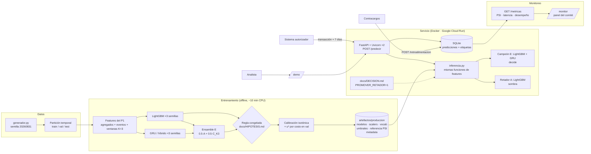
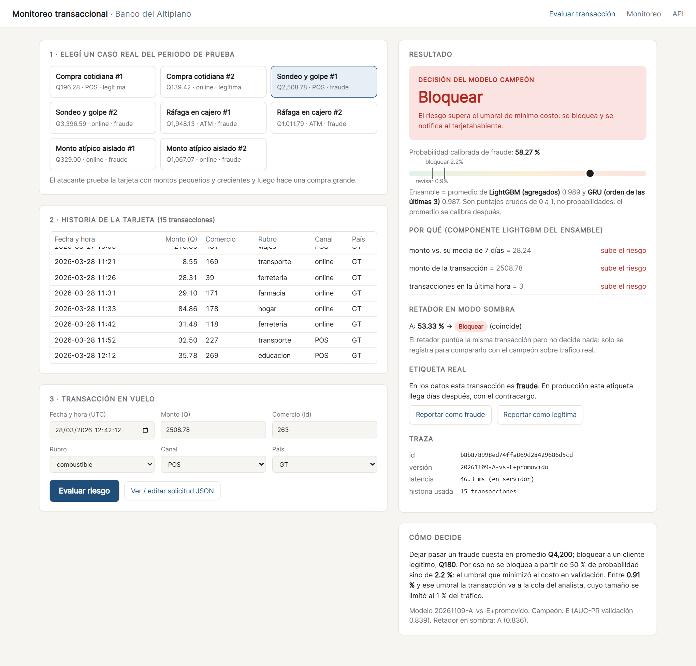
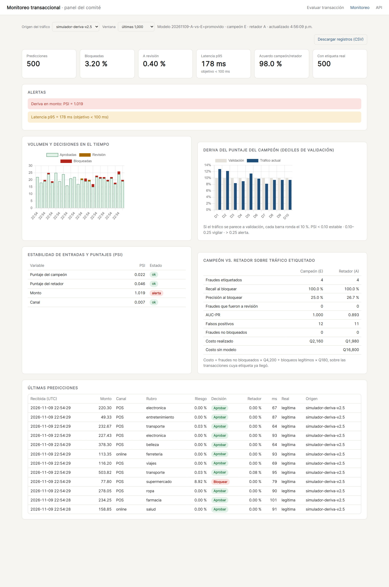

# Proyecto Final — Un modelo de Deep Learning en producción

**Monitoreo transaccional del Banco del Altiplano: un ensamble LightGBM + GRU decide, con monitoreo campeón/retador**

Deep Learning y Sistemas Inteligentes 2026 · Universidad del Valle de Guatemala · Kevin Recinos
**Integrantes:** Andrés Mazariegos (21749) · June Herrera
**Modelo de origen:** [Proyecto 1 — Monitoreo transaccional](https://github.com/UVG-Work/Proyecto-1-Deeplearning/tree/feat/monitoreo-transaccional)

| | |
|---|---|
| **Servicio en producción** | <https://monitoreo-transaccional-837352528666.us-central1.run.app> (Google Cloud Run) |
| Demo para el analista | `/` |
| Panel de monitoreo | `/monitor` |
| Documentación de la API | `/docs` |
| Presentación | [`docs/presentacion.pdf`](docs/presentacion.pdf) |

> **En una línea.** Un servicio web recibe la transacción que se está autorizando más
> la historia de 7 días de la tarjeta, devuelve probabilidad calibrada de fraude y la
> decisión **bloquear / revisar / aprobar** con un umbral de mínimo costo. Decide un
> **ensamble**: la mitad del puntaje viene de un **GRU** (Deep Learning, lee el orden de
> las últimas 3 transacciones) y la otra mitad de LightGBM (agregados). LightGBM solo
> corre en **modo sombra**, y el panel compara a los dos sobre tráfico real. Por la regla
> técnica que fijamos antes de entrenar, LightGBM solo era marginalmente más barato; promover el
> ensamble fue una decisión de negocio declarada y cuantificada en
> [`docs/DECISION.md`](docs/DECISION.md).

---

## 1. Problemática

**Problema.** Un fraude con tarjeta que se deja pasar le cuesta al banco en promedio
**Q4,200** (contracargo, gestión y pérdida); bloquear por error a un cliente legítimo
cuesta **Q180** (llamada al centro de servicio, compra perdida, riesgo de que deje de
usar la tarjeta). La decisión tiene que tomarse **en el momento de la autorización**,
en milisegundos, sin saber todavía si la transacción es fraude.

**Usuario.** Dos usuarios, con necesidades distintas:

- **El sistema autorizador del banco**, que llama a la API por cada transacción y
  necesita una respuesta en menos de 100 ms (p95).
- **El analista de riesgos**, que atiende la cola de revisión manual y necesita saber
  *por qué* el modelo marcó una transacción para poder llamar al cliente con criterio.

**Decisión que depende del modelo.** Por cada transacción en vuelo:

| Puntaje calibrado `p` | Acción | Quién actúa |
|---|---|---|
| `p ≥ u*` (2.2 %) | **Bloquear** y notificar al tarjetahabiente | automático |
| `u_rev ≤ p < u*` (0.91 %–2.2 %) | **Revisar**: se autoriza, pero entra a la cola del analista | analista |
| `p < u_rev` | **Aprobar** | automático |

Un tercer usuario es **el comité técnico y de negocio**, que decide —con el panel de
monitoreo— si el modelo se mantiene, se reentrena o se promueve al retador.

## 2. Planificación

| Etapa | Fecha | Entregable | Responsable _(confirmar)_ |
|---|---|---|---|
| Selección del modelo de origen y revisión del P1 | 8 nov | Decisión: P1 sobre P2 (GAN) y P3 (Text-to-SQL) | Ambos |
| Hipótesis y criterio de éxito congelados | 8 nov, 20:26 GT | [`docs/HIPOTESIS.md`](docs/HIPOTESIS.md) (SHA-256 en metadata) | Andrés Mazariegos |
| Reentrenamiento `K = 3` y paquete de producción | 8 nov | `artefactos/produccion/`, `entrenamiento/log_entrenamiento.txt` | June Herrera |
| Servicio: API, demo, registro y monitoreo | 8 nov | `servicio/` | Andrés Mazariegos |
| Pruebas de contrato y de paridad | 8 nov | `tests/` (76 pruebas) | June Herrera |
| Hipótesis H3 (ensamble), registrada antes de calcularlo | 8 nov, 21:41 GT | adenda en `docs/HIPOTESIS.md` (commit `c283851`) | Andrés Mazariegos |
| Decisión de producción: promover el ensamble | 8 nov, 21:50 GT | [`docs/DECISION.md`](docs/DECISION.md) | Ambos |
| Despliegue en Google Cloud Run | 9 nov | URL pública | Andrés Mazariegos |
| Tráfico de prueba y evidencias | 9 nov | `evidencias/`, panel con datos | June Herrera |
| Presentación al comité | 9 / 13 nov | `docs/presentacion.pdf` | Ambos |
| Ajustes y versión final del repositorio | hasta 15 nov, 23:59 | última versión en GitHub | Ambos |

Por qué en este orden: la hipótesis se escribió **antes** de entrenar (el criterio no
puede moverse después de ver resultados), y la prueba de paridad se escribió **antes**
de desplegar (si el servicio calcula features distinto que el entrenamiento, todo lo
demás es irrelevante).

## 3. Supuestos

**Sobre los datos**

- Los datos son **sintéticos**, generados con el mismo generador y la misma semilla del
  Proyecto 1 (`SEED_DATOS = 20260831`, 419,821 transacciones de 4,000 tarjetas en 90
  días, 1.18 % de fraude). Es la limitación que gobierna todas las demás: el sistema
  demuestra el *pipeline* de producción, no que el patrón de fraude exista con esta
  forma en el banco real.
- La partición es **temporal global**: train hasta el 5 de marzo, validación hasta el
  18, prueba hasta el 31. Nada se ajusta mirando prueba.
- Las etiquetas llegan **con retraso** (contracargos). El servicio no las necesita para
  decidir; las recibe después por `POST /retroalimentacion` para medir desempeño real.

**Sobre el usuario**

- El sistema autorizador puede enviar la historia de **7 días** de la tarjeta (es la
  ventana más larga que usan las features; mandar más no cambia el puntaje y hay una
  prueba que lo verifica).
- El equipo de analistas puede revisar como máximo **1 % del tráfico**. Ese supuesto fija
  el límite inferior de la banda de revisión.
- Los costos FN = Q4,200 y FP = Q180 son promedios fijos. En la realidad el costo de un
  FN escala con el monto y el de un FP depende del cliente.

**Sobre el entorno**

- Se sirve en CPU: Google Cloud Run con 2 vCPU y 2 GiB, una sola instancia. No hace
  falta GPU: el GRU híbrido del ensamble tiene 27,457 parámetros. El plan original era
  Hugging Face Spaces, pero desde 2026 un Space con Docker en CPU Basic exige cuenta PRO,
  y las capas gratuitas de 512 MB de otros servicios no alcanzan (cada worker usa
  ~450 MB). Cloud Run cobra solo mientras atiende solicitudes y la demo cabe en su capa
  gratuita.
- El registro de uso (SQLite) es efímero: Cloud Run apaga la instancia tras unos
  minutos sin tráfico y con ella se borra el registro. La primera solicitud después
  tarda unos segundos más (arranque en frío). Por eso `GET /registros.csv` permite
  exportar la evidencia, y el tráfico de prueba se vuelve a correr antes de presentar.
  Con un disco persistente el servicio usa `/data` automáticamente.

## 4. Modelo planteado

**Proyecto de origen:** Proyecto 1 (monitoreo transaccional), de Andrés Mazariegos y
June Herrera. Se eligió sobre el Proyecto 2 (GAN de personajes) y el Proyecto 3
(Text-to-SQL) porque es el único con un usuario que toma una decisión con costo
medible, una línea base contra la cual validar y una noción natural de deriva.

**Lo que se conserva del P1** —sin tocarlo— es todo el código de datos y features
(`src/monitoreo/`): generador, partición temporal, agregados causales del Modelo A,
features de evento del Modelo B, ventanas, calibración isotónica y umbral por costo.

**Arquitectura servida**

```
Campeón — E: ensamble   puntaje = 0.5 · crudo(A) + 0.5 · crudo(C_K3)  →  calibración isotónica  →  u* = 2.2 %

  Componente C_K3: GRU híbrido (Deep Learning)
    últimas 3 transacciones ─► [7 numéricas + emb(mcc,8) + emb(canal,4) + emb(comercio,16)]
                            ─► GRU(64, con máscara) ─► Dropout(0.3) ─┐
    30 agregados causales (escalados) ─────────────────────────────┴► Concat ─► Dense(32) ─► sigmoide

  Componente A: LightGBM sobre los 30 agregados causales (sin orden)

Retador en sombra — A: el mismo LightGBM, solo (con su propio calibrador y u* = 1.6 %)
```

**Por qué un ensamble.** A no puede leer el orden de las transacciones (sus agregados
son invariantes a la permutación) y C_K3 sí lo usa. Si sus errores no coinciden, el
promedio corrige parte de los errores de cada uno. El peso 0.5 se fijó **antes** de
calcular nada: buscarlo en validación y medir en validación inflaría el resultado.

**El cambio, justificado.** Uno solo: **`K = 20 → 3`**. La curva de recorte de historia
del P1 (su propia prueba de falsificación) mostró que con `K = 20` el GRU estaba en su
peor configuración (0.636 de AUC-PR contra 0.749 con `K = 3`) y el README del P1 dejó
escrito que era lo primero a corregir. Con `K = 20` y 30 épocas fijas, el GRU tenía
que aprender a ignorar 17 pasos de relleno o de historia irrelevante; el mecanismo de
fraude "sondeo y golpe" vive en los últimos pasos. Se mantuvieron idénticos datos,
partición, semillas e hiperparámetros para poder atribuir cualquier cambio a `K`.

## 5. Validación de hipótesis

Las hipótesis, métricas y criterios se escribieron **antes de entrenar** en
[`docs/HIPOTESIS.md`](docs/HIPOTESIS.md): H1 y H2 a las 02:26 UTC, antes de entrenar
cualquier modelo; H3 (ensamble) a las 03:41 UTC, antes de calcular cualquier puntaje del
ensamble, en un commit propio (`c283851`). El entrenamiento guarda el SHA-256 del
archivo (`319d31a2…`) en `artefactos/produccion/metadata.json`.

**Métrica:** AUC-PR de validación, media de 3 semillas `(7, 13, 29)`. AUC-PR y no
exactitud: con 1.2 % de fraude, un modelo que nunca bloquea tiene 98.8 % de exactitud.

| Modelo | Semilla 7 | Semilla 13 | Semilla 29 | Media ± desv. |
|---|---:|---:|---:|---:|
| **A — LightGBM (línea base)** | 0.8317 | 0.8312 | 0.8357 | **0.8329 ± 0.0020** |
| B — GRU, `K = 20` (P1) | | | | 0.7138 ± 0.0685 |
| **B — GRU, `K = 3`** | 0.7490 | 0.7449 | 0.7433 | **0.7457 ± 0.0024** |
| C — híbrido, `K = 20` (P1) | | | | 0.6939 ± 0.0311 |
| **C — híbrido, `K = 3`** | 0.7746 | 0.7858 | 0.7857 | **0.7820 ± 0.0052** |
| **E — ensamble 0.5·A + 0.5·C_K3** (pares de igual semilla) | 0.8325 | 0.8387 | 0.8380 | **0.8364 ± 0.0028** |

| Hipótesis | Criterio (definido antes) | Resultado | Veredicto |
|---|---|---|---|
| **H1** — el GRU con `K = 3` supera al de `K = 20` | mejora media ≥ 0.03 **y** peor semilla > 0.7138 | +0.0319; peor semilla 0.7433 | ✅ **Se cumple** |
| **H2** — el híbrido `K = 3` iguala a LightGBM | `media(C_K3) ≥ media(A) − 0.005` | −0.0509 | ❌ **No se cumple** |
| **H3** — el ensamble no es peor que A | AUC-PR ≥ A **y** costo en `u*` ≤ A (medias) | AUC-PR +0.0035; costo Q281,720 vs. Q270,560 | ❌ **No se cumple** (falla el costo) |

**Lo que dicen los resultados.** H1 se cumple por poco en la media, pero el efecto
grande está en la **estabilidad**: la desviación entre semillas cae de 0.068 a 0.002.
Con `K = 20` el resultado dependía de la suerte de la inicialización; con `K = 3` no.
H2 no se cumple: el híbrido mejora 0.088 respecto a su versión `K = 20`, pero sigue 0.05
por debajo de LightGBM.

**Prueba de permutación** (falsificación, sobre el retador servido, validación): barajar
la ventana completa hace caer su AUC-PR de 0.786 a 0.661; barajar solo la historia
(dejando la transacción actual en su lugar), a 0.761. El modelo **sí** usa el orden, y
la parte del orden que aporta está más en la posición de la transacción actual que en
la de las previas.

**Regla técnica (congelada) → campeón A, retador E.** E ordena mejor (AUC-PR) pero, en
su umbral óptimo, cuesta más en validación; como H3 exigía ambas cosas, por la regla
decide A. Los artefactos reflejan exactamente eso.

**Decisión de negocio → se promueve E.** Con A como campeón, el modelo de Deep Learning
no participaría en ninguna decisión. En prueba, E cuesta **Q4,560 más al mes** que A: el
0.08 % del ahorro mensual que da cualquiera de los dos. Asumimos ese costo de forma
explícita, documentada en [`docs/DECISION.md`](docs/DECISION.md) e implementada como una
sola línea del Dockerfile (`PROMOVER_RETADOR=1`). Quitarla devuelve el servicio a la
regla técnica sin reentrenar. A queda en sombra precisamente para que el panel diga, con
tráfico real, si la decisión se sostiene.

**Prueba, evaluada una sola vez** (2026-11-09 02:38 UTC, con todo congelado; 13.4 días,
62,974 transacciones, 703 fraudes):

| | AUC-PR | Recall al bloquear | Precisión | Costo en prueba | Ahorro mensual vs. sin modelo |
|---|---:|---:|---:|---:|---:|
| **E — ensamble (decide)** | 0.853 | 97.6 % | 39.1 % | Q263,460 | **Q6.01 M** |
| A — LightGBM (sombra) | 0.857 | 97.7 % | 38.9 % | Q261,420 | Q6.02 M |
| C_K3 — GRU híbrido solo | 0.789 | 94.2 % | 38.2 % | Q364,800 | Q5.79 M |
| Sin modelo (aprobar todo) | — | 0 % | — | Q2,952,600 | — |

Desglose por mecanismo de fraude (recall al bloquear, E / A): sondeo y golpe 100 % /
100 %; sondeos previos 94.8 % / 95.2 %; ráfaga en cajero 100 % / 100 %; monto atípico
97.8 % / 97.8 %. El GRU solo (C_K3) se evaluó en prueba en la primera corrida, cuando era
el retador; su fila se conserva como referencia.

## 6. Herramientas y arquitectura



| Capa | Herramienta | Por qué |
|---|---|---|
| Modelos | Keras 3 (backend torch) · LightGBM | Los mismos del P1; el `.keras` es independiente del backend |
| API | FastAPI + Pydantic + Uvicorn | Validación de entradas declarativa y documentación `/docs` gratis |
| Registro | SQLite | Sin servidor extra; suficiente para miles de predicciones por hora |
| Monitoreo | PSI propio + Chart.js (empaquetado local) | Sin dependencias externas en tiempo de ejecución |
| Contenedor | Docker (`python:3.13-slim`, torch CPU) | Reproducible; la imagen no trae CUDA (~2 GB menos) |
| Hosting | Google Cloud Run (2 vCPU, 2 GiB, 1 instancia) | Corre el mismo Dockerfile sin cambios, URL pública fija y cobro por solicitud (dentro de la capa gratuita). Hugging Face Spaces con Docker ya exige cuenta PRO |

**Decisiones de diseño que vale la pena defender**

1. **Cero reimplementación de features.** `servicio/inferencia.py` arma un mini
   DataFrame con la historia + la transacción nueva y llama a las *mismas* funciones del
   entrenamiento. `tests/test_paridad.py` verifica, sobre 40 transacciones reales de
   prueba (15 fraudes), que el puntaje del servicio coincide con el del pipeline por
   lotes con diferencia < 1e-5 en ambos modelos. Esta prueba atrapó un bug real antes
   de desplegar: timestamps con y sin microsegundos se parseaban mal.
2. **Campeón / retador en sombra.** Cambiar de modelo sin compararlo en tráfico real es
   apostar. El retador ve exactamente lo mismo que el campeón y su decisión se registra
   pero no se ejecuta. Los roles se intercambian con `PROMOVER_RETADOR=1`, sin
   reentrenar: cada modelo conserva su calibrador y sus umbrales. Así se implementó la
   decisión de promover el ensamble, y así se revierte si el panel la contradice.
3. **Monitoreo en tres preguntas.** ¿Funciona? (volumen, latencia p95). ¿Cambió el mundo?
   (PSI del puntaje, del monto y del canal contra validación, en ventana móvil). ¿Sigue
   acertando? (recall, precisión y costo realizado de campeón y retador sobre las
   transacciones cuya etiqueta ya llegó).
4. **Explicabilidad para el analista.** Se devuelven las 3 variables con mayor
   contribución SHAP del componente LightGBM (`pred_contrib`), en lenguaje de negocio,
   y el puntaje de cada componente del ensamble, para ver si el riesgo lo empujó el GRU
   (orden) o los agregados.

## 7. Evidencias del pase a producción

**Enlace al servicio:** <https://monitoreo-transaccional-837352528666.us-central1.run.app>
(Google Cloud Run, `us-central1`)

**Pruebas automáticas** — `python -m pytest` → **76 pruebas, todas pasan** (~1 min):

| Archivo | Qué garantiza |
|---|---|
| `test_paridad.py` | El servicio reproduce el puntaje del entrenamiento para A y para el ensamble (componente por componente); recortar historia vieja no cambia nada |
| `test_api.py` | Contrato: respuestas válidas, decisión coherente con umbrales, rechazo (422) de canal/rubro/monto/fecha inválidos y de transacciones anteriores a su historia, retroalimentación, exportación, y que `PROMOVER_RETADOR=1` intercambie roles |
| `test_supervision.py` | El PSI calla con tráfico estable y alerta con montos inflados o una mezcla de canales nueva |
| `test_features_*`, `test_ventanas`, `test_particion`, `test_economia`, `test_calibracion`, `test_metricas` | Heredadas del P1: causalidad de features, sin fuga, umbral por costo |

**Tráfico de prueba** (`scripts/simular_trafico.py` reproduce transacciones consecutivas
del periodo de prueba, como las mandaría el autorizador, y luego sus etiquetas). Servidor
en la configuración de producción (ensamble decidiendo, A en sombra):
[`evidencias/corrida_local.txt`](evidencias/corrida_local.txt)

| Corrida | Transacciones | Errores | Rendimiento | Latencia en servidor p50 / p95 |
|---|---:|---:|---:|---:|
| 1 cliente | 400 | 0 | 24 tx/s | 37 / 47 ms |
| 4 clientes, 1 proceso (antes del ajuste) | 1,500 | 0 | 20 tx/s | 168 / 252 ms ❌ |
| 4 clientes, 2 procesos (4 corridas) | 300–500 c/u | 0 | 46–54 tx/s | 62–69 / 88–139 ms |
| 4 clientes, 2 procesos, corrida larga | 2,000 | 0 | 21 tx/s | 160 / 239 ms ❌ |

**Corrida contra producción** (2026-11-09, 22:46 UTC, contra la URL pública desde
Guatemala; mismas transacciones que la corrida local):
[`evidencias/corrida_produccion.txt`](evidencias/corrida_produccion.txt) ·
registros exportados en [`evidencias/registros_produccion.csv`](evidencias/registros_produccion.csv)

| | Local · normal | **Producción · normal** | Local · deriva ×2.5 | **Producción · deriva ×2.5** |
|---|---:|---:|---:|---:|
| Comando | `--n 2000 --hilos 4` | `--n 2000 --hilos 4 --semilla 1` | `--n 500 --deriva 2.5` | `--n 500 --hilos 4 --deriva 2.5 --semilla 5` |
| Transacciones (fraudes) | 2,000 (43) | **2,000 (43)** | 500 (4) | **500 (4)** |
| Errores | 0 | **0** | 0 | **0** |
| Rendimiento | 21.3 tx/s | **19.7 tx/s** | 53.8 tx/s | **18.7 tx/s** |
| Latencia en servidor p50 / p95 | 160 / 239 ms ❌ | **91 / 166 ms ❌** | 62 / 92 ms | **92 / 178 ms ❌** |
| Latencia ida y vuelta p50 / p95 | 186 / 273 ms | 201 / 292 ms | 70 / 102 ms | 209 / 311 ms |
| Recall al bloquear — E (decide) / A (sombra) | 100 % / 100 % | **100 % / 100 %** | — | **100 % / 100 %** |
| Costo realizado — E / A | Q6,120 / Q6,300 | **Q6,120 / Q6,300** | — | **Q2,160 / Q1,980** |
| PSI del monto | — | 0.003 | 1.02 → alerta | **1.019 → alerta** |
| PSI del puntaje del ensamble | — | 0.054 | 0.02 | **0.022** |

"—": no se registró en esa corrida. La latencia en servidor la mide la propia API y
no incluye la red; la de ida y vuelta, sí.

Lo que dicen las dos corridas juntas:

1. **Producción decide exactamente lo mismo que local.** Las mismas 2,000 transacciones
   dieron las mismas decisiones (1,902 aprobadas, 21 a revisión, 77 bloqueadas) y el
   mismo costo. Es la paridad de `test_paridad.py`, ahora comprobada en el contenedor
   desplegado.
2. **En producción no se cumple el objetivo p95 < 100 ms con 4 clientes concurrentes.**
   El p95 fue de 166 y 178 ms; el p50 se mantuvo en 91–92 ms. Las solicitudes sueltas de
   la demo tardaron entre 38 y 61 ms en servidor, pero no medimos una corrida de un solo
   cliente en producción. Localmente ya habíamos visto que la concurrencia es lo que
   dispara la latencia:
   - **Con un solo proceso**, las solicitudes concurrentes hacen fila detrás del GIL de
     Python, porque el cálculo de features con pandas no se paraleliza dentro de un
     proceso. Por eso se pasó a 2 workers de Uvicorn, uno por vCPU (p95 de 252 a
     88–139 ms en la mayoría de las corridas locales).
   - **Con 2 procesos, el resultado varía entre corridas.** Las conexiones *keep-alive*
     se quedan con el worker que las aceptó; si las 4 caen en el mismo, se pierde el
     paralelismo. Eso pasó en la corrida local larga (239 ms).

   En Cloud Run el p95 quedó entre esos dos extremos en ambas corridas; no aislamos más
   la causa. La solución de fondo es repartir por solicitud y no por conexión, o tener
   más réplicas. Queda como limitación declarada.
3. **El monitoreo detecta deriva.** Con montos ×2.5, el PSI del monto sube a **1.02 →
   alerta**, local y en producción, mientras el PSI del puntaje del ensamble se queda en
   0.02. Lectura: las entradas cambiaron pero el modelo no se desestabilizó, porque sus
   variables principales son relativas (monto contra la media de 7 días de la tarjeta).
   Una alerta de entrada no es lo mismo que un modelo roto, y el panel permite
   distinguirlas.

**Desempeño sobre tráfico etiquetado** (producción; 2,000 transacciones normales, 43 fraudes):

| | Recall al bloquear | Precisión | Falsos positivos | Costo realizado |
|---|---:|---:|---:|---:|
| **E — ensamble (decide)** | 100 % | 55.8 % | 34 | **Q6,120** |
| A — LightGBM (sombra) | 100 % | 55.1 % | 35 | Q6,300 |
| Sin modelo | 0 % | — | 0 | Q180,600 |

En el tramo normal el ensamble salió Q180 más barato que A, al revés que en prueba; en
el tramo con deriva fue al revés (A, Q1,980 contra Q2,160 del ensamble: un falso positivo
menos). Con 43 y 4 fraudes la diferencia no es significativa en ninguna dirección; es
exactamente lo que el panel debe seguir acumulando antes de revisar la decisión de
`docs/DECISION.md`.

| | |
|---|---|
|  |  |
| Demo: un "sondeo y golpe" real del periodo de prueba, bloqueado por el ensamble; puntaje de cada componente, motivos y retador | Panel filtrado al tráfico con deriva: alerta en monto, puntaje estable |

Capturas tomadas del servicio desplegado (`tools/capturas.py <URL>`). Registros de uso:
`GET /registros.csv` en el servicio; la exportación de la corrida está en
[`evidencias/registros_produccion.csv`](evidencias/registros_produccion.csv) (2,502
predicciones: 2,000 normales, 500 con deriva y 2 de la demo).

---

## Ejecución

```bash
python -m venv .venv && source .venv/bin/activate     # Windows: .venv\Scripts\activate
pip install -r requirements.txt

# 1. Pruebas (76, ~1 min)
python -m pytest

# 2. Entrenar el paquete de producción (~10 min en CPU; reproduce las cifras de §5)
python -m entrenamiento.entrenar
#    modo rápido para probar el pipeline: MONITOREO_DEV=1 python -m entrenamiento.entrenar

# 3. Servir localmente (igual que producción: decide el ensamble)
PROMOVER_RETADOR=1 uvicorn servicio.app:app --port 7860 --workers 2   # abrir http://localhost:7860
#    sin PROMOVER_RETADOR se sirve la configuración de la regla técnica (decide A)

# 4. Mandar tráfico real del periodo de prueba (y, opcional, deriva)
python -m scripts.simular_trafico --url http://localhost:7860 --n 2000 --hilos 4
python -m scripts.simular_trafico --url http://localhost:7860 --n 500 --deriva 2.5

# 5. Con Docker (igual que en producción)
docker build -t monitoreo . && docker run -p 7860:7860 monitoreo
```

**Desplegar en Google Cloud Run.** Con `gcloud` autenticado y un proyecto con
facturación y las APIs `run`, `cloudbuild` y `artifactregistry` habilitadas:

```bash
./despliegue/publicar_cloudrun.sh <proyecto-gcp> [region]    # región por defecto: us-central1
```

Construye la imagen con el mismo `Dockerfile` en Cloud Build y la despliega con 2 vCPU,
2 GiB, una sola instancia (un solo registro SQLite) y escala a cero. Con una cuenta PRO
de Hugging Face, `./despliegue/publicar_hf.sh <usuario>/<space>` publica el mismo
contenedor en un Space con SDK Docker.

**Ejemplo de llamada a la API**

```bash
curl -X POST https://monitoreo-transaccional-837352528666.us-central1.run.app/predecir \
  -H "Content-Type: application/json" \
  -d '{"card_id": 17,
       "historial": [{"ts":"2026-03-28T11:21:00Z","amount":8.55,"merchant_id":169,"mcc":"transporte","channel":"online","country":"GT"},
                     {"ts":"2026-03-28T11:26:00Z","amount":28.31,"merchant_id":39,"mcc":"ferreteria","channel":"online","country":"GT"}],
       "transaccion": {"ts":"2026-03-28T12:42:12Z","amount":2508.78,"merchant_id":263,"mcc":"combustible","channel":"POS","country":"GT"}}'
```

Respuesta (abreviada): `{"risk_score": 0.58, "decision": "block", "umbral_bloqueo": 0.022,
"componentes": {"A": 0.989, "C_K3": 0.987}, "motivos": [...],
"retador": {"familia": "A", "risk_score": 0.53, "decision": "block"},
"model_version": "20261109-A-vs-E+promovido", "latencia_ms": 46}`

**Estructura**

```
src/monitoreo/         código de datos, features y modelos del Proyecto 1 (sin cambios)
entrenamiento/         entrenar.py + log de la corrida que produjo los artefactos
artefactos/produccion/ modelos, preprocesadores, umbrales, referencia de monitoreo, metadata
servicio/              app.py (API), inferencia.py, registro.py, supervision.py, static/ (demo y panel)
scripts/               escenarios de la demo y simulador de tráfico
tests/                 contrato de la API, paridad, monitoreo y pruebas heredadas del P1
despliegue/            scripts de publicación (Cloud Run y Hugging Face) y README del Space
docs/                  HIPOTESIS.md, DECISION.md y presentacion.pdf
evidencias/            corrida de tráfico y capturas
```

**Versiones:** Python 3.13 · numpy 2.3.5 · pandas 2.3.3 · scikit-learn 1.8.0 · Keras 3.15.1
(backend torch 2.15.0) · LightGBM 4.7.0 · FastAPI 0.162 · Uvicorn 0.54. numpy, pandas y
scikit-learn están fijadas a las del P1: con ellas el generador reproduce exactamente el
mismo dataset.

## Limitaciones y siguientes pasos

- **Datos sintéticos.** Antes de una decisión real hay que repetir el experimento con el
  flujo del banco (`card_id` + `ts`).
- **El ensamble decide por decisión de negocio, no por la regla técnica.** Por la regla
  congelada (H3) ganaba LightGBM por Q4,560/mes en prueba. La decisión está declarada,
  cuantificada y es reversible con una línea; A en sombra existe para revisarla.
- **El peso del ensamble (0.5) no se optimizó.** Hacerlo bien exige un conjunto de datos
  que no se haya usado ni para calibrar ni para elegir el umbral.
- **Latencia sobre el objetivo con tráfico concurrente** (ver §7): en Cloud Run, con 4
  clientes, el p95 fue de 166–178 ms contra el objetivo de 100 ms. Falta un balanceo
  por solicitud o más réplicas.
- **Calibrador y umbral se ajustan ambos en validación** y heredan su optimismo.
- **Registro efímero:** se borra cuando Cloud Run apaga la instancia por inactividad.
  En producción iría a una base administrada.
- **Sin autenticación** en `/predecir`: en un banco iría detrás de un gateway con mTLS.

## Declaración de uso de IA

Se usó **Claude (Anthropic)** como asistente de programación para: revisar el código del
Proyecto 1 y proponer qué llevar a producción; proponer el ensamble y redactar su hipótesis; redactar el script de entrenamiento, el
servicio (API, inferencia, registro, monitoreo), la interfaz web, las pruebas, el
simulador de tráfico, el Dockerfile y el borrador de este README y de la presentación.
Las hipótesis y la regla de decisión se discutieron y fijaron antes de entrenar.

_Completar por cada integrante antes de entregar — qué usó y qué verificó personalmente:_

- **Andrés Mazariegos** — _______
- **June Herrera** — _______

Cada integrante debe poder explicar cualquier parte del código; la sección de decisiones
(§6) y la de hipótesis (§5) son las que más probablemente salgan en preguntas.
