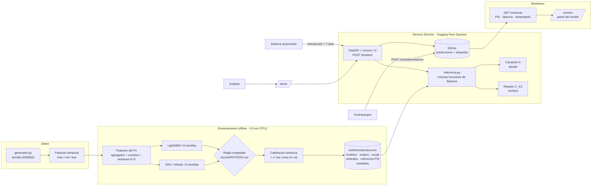
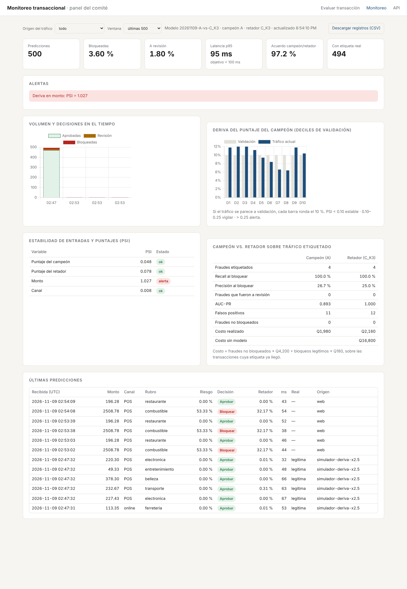

# Proyecto Final — Un modelo de Deep Learning en producción

**Monitoreo transaccional del Banco del Altiplano: API de riesgo con campeón y retador**

Deep Learning y Sistemas Inteligentes 2026 · Universidad del Valle de Guatemala · Kevin Recinos
**Integrantes:** Andrés Mazariegos (21749) · June Herrera · _[Integrante 3]_
**Modelo de origen:** [Proyecto 1 — Monitoreo transaccional](https://github.com/UVG-Work/Proyecto-1-Deeplearning/tree/feat/monitoreo-transaccional)

| | |
|---|---|
| **Servicio en producción** | `https://<usuario>-monitoreo-transaccional.hf.space` _(completar tras desplegar)_ |
| Demo para el analista | `/` |
| Panel de monitoreo | `/monitor` |
| Documentación de la API | `/docs` |
| Presentación | [`docs/presentacion.pdf`](docs/presentacion.pdf) |

> **En una línea.** Un servicio web recibe la transacción que se está autorizando más
> la historia de 7 días de la tarjeta, devuelve probabilidad calibrada de fraude y la
> decisión **bloquear / revisar / aprobar** con un umbral de mínimo costo. El modelo de
> Deep Learning (GRU híbrido, `K = 3`) puntúa en **modo sombra** junto al campeón
> LightGBM, y el panel de monitoreo compara a los dos sobre tráfico real para que el
> comité decida si promoverlo.

---

## 1. Problemática

**Problema.** Un fraude con tarjeta que se deja pasar le cuesta al banco en promedio
**Q4,200** (contracargo, gestión y pérdida); bloquear por error a un cliente legítimo
cuesta **Q180** (llamada al centro de servicio, compra perdida, riesgo de que deje de
usar la tarjeta). La decisión tiene que tomarse **en el momento de la autorización**,
en milisegundos, sin saber todavía si la transacción es fraude.

**Usuario.** Dos usuarios, con necesidades distintas:

- **El sistema autorizador del banco**, que llama a la API por cada transacción y
  necesita una respuesta en menos de 100 ms (p95).
- **El analista de riesgos**, que atiende la cola de revisión manual y necesita saber
  *por qué* el modelo marcó una transacción para poder llamar al cliente con criterio.

**Decisión que depende del modelo.** Por cada transacción en vuelo:

| Puntaje calibrado `p` | Acción | Quién actúa |
|---|---|---|
| `p ≥ u*` (1.6 %) | **Bloquear** y notificar al tarjetahabiente | automático |
| `u_rev ≤ p < u*` (0.23 %–1.6 %) | **Revisar**: se autoriza, pero entra a la cola del analista | analista |
| `p < u_rev` | **Aprobar** | automático |

Un tercer usuario es **el comité técnico y de negocio**, que decide —con el panel de
monitoreo— si el modelo se mantiene, se reentrena o se promueve al retador.

## 2. Planificación

| Etapa | Fecha | Entregable | Responsable _(confirmar)_ |
|---|---|---|---|
| Selección del modelo de origen y revisión del P1 | 8 nov | Decisión: P1 sobre P2 (GAN) y P3 (Text-to-SQL) | Todo el trío |
| Hipótesis y criterio de éxito congelados | 8 nov, 20:26 GT | [`docs/HIPOTESIS.md`](docs/HIPOTESIS.md) (SHA-256 en metadata) | Andrés Mazariegos |
| Reentrenamiento `K = 3` y paquete de producción | 8 nov | `artefactos/produccion/`, `entrenamiento/log_entrenamiento.txt` | June Herrera |
| Servicio: API, demo, registro y monitoreo | 8 nov | `servicio/` | Andrés Mazariegos |
| Pruebas de contrato y de paridad | 8 nov | `tests/` (75 pruebas) | _[Integrante 3]_ |
| Despliegue en Hugging Face Spaces | 9 nov | URL pública | _[Integrante 3]_ |
| Tráfico de prueba y evidencias | 9 nov | `evidencias/`, panel con datos | June Herrera |
| Presentación al comité | 9 / 13 nov | `docs/presentacion.pdf` | Todo el trío |
| Ajustes y versión final del repositorio | hasta 15 nov, 23:59 | última versión en GitHub | Todo el trío |

Por qué en este orden: la hipótesis se escribió **antes** de entrenar (el criterio no
puede moverse después de ver resultados), y la prueba de paridad se escribió **antes**
de desplegar (si el servicio calcula features distinto que el entrenamiento, todo lo
demás es irrelevante).

## 3. Supuestos

**Sobre los datos**

- Los datos son **sintéticos**, generados con el mismo generador y la misma semilla del
  Proyecto 1 (`SEED_DATOS = 20260831`, 419,821 transacciones de 4,000 tarjetas en 90
  días, 1.18 % de fraude). Es la limitación que gobierna todas las demás: el sistema
  demuestra el *pipeline* de producción, no que el patrón de fraude exista con esta
  forma en el banco real.
- La partición es **temporal global**: train hasta el 5 de marzo, validación hasta el
  18, prueba hasta el 31. Nada se ajusta mirando prueba.
- Las etiquetas llegan **con retraso** (contracargos). El servicio no las necesita para
  decidir; las recibe después por `POST /retroalimentacion` para medir desempeño real.

**Sobre el usuario**

- El sistema autorizador puede enviar la historia de **7 días** de la tarjeta (es la
  ventana más larga que usan las features; mandar más no cambia el puntaje y hay una
  prueba que lo verifica).
- El equipo de analistas puede revisar como máximo **1 % del tráfico**. Ese supuesto fija
  el límite inferior de la banda de revisión.
- Los costos FN = Q4,200 y FP = Q180 son promedios fijos. En la realidad el costo de un
  FN escala con el monto y el de un FP depende del cliente.

**Sobre el entorno**

- Se sirve en CPU (2 vCPU del plan gratuito de Hugging Face Spaces). No hace falta GPU:
  el retador (GRU híbrido, `K = 3`) tiene 27,457 parámetros.
- El almacenamiento del Space gratuito es efímero: el registro de uso (SQLite) se
  reinicia si el Space se reinicia. Con almacenamiento persistente el servicio usa
  `/data` automáticamente. Por eso `GET /registros.csv` permite exportar la evidencia.

## 4. Modelo planteado

**Proyecto de origen:** Proyecto 1 (monitoreo transaccional), de Andrés Mazariegos y
June Herrera. Se eligió sobre el Proyecto 2 (GAN de personajes) y el Proyecto 3
(Text-to-SQL) porque es el único con un usuario que toma una decisión con costo
medible, una línea base contra la cual validar y una noción natural de deriva.

**Lo que se conserva del P1** —sin tocarlo— es todo el código de datos y features
(`src/monitoreo/`): generador, partición temporal, agregados causales del Modelo A,
features de evento del Modelo B, ventanas, calibración isotónica y umbral por costo.

**Arquitectura servida**

```
Retador — C_K3: GRU híbrido (Deep Learning)
  últimas 3 transacciones ─► [7 numéricas + emb(mcc,8) + emb(canal,4) + emb(comercio,16)]
                          ─► GRU(64, con máscara) ─► Dropout(0.3) ─┐
  30 agregados causales (escalados) ─────────────────────────────┴► Concat ─► Dense(32) ─► sigmoide

Campeón — A: LightGBM sobre los 30 agregados causales (sin orden)
```

**El cambio, justificado.** Uno solo: **`K = 20 → 3`**. La curva de recorte de historia
del P1 (su propia prueba de falsificación) mostró que con `K = 20` el GRU estaba en su
peor configuración (0.636 de AUC-PR contra 0.749 con `K = 3`) y el README del P1 dejó
escrito que era lo primero a corregir. Con `K = 20` y 30 épocas fijas, el GRU tenía
que aprender a ignorar 17 pasos de relleno o de historia irrelevante; el mecanismo de
fraude "sondeo y golpe" vive en los últimos pasos. Se mantuvieron idénticos datos,
partición, semillas e hiperparámetros para poder atribuir cualquier cambio a `K`.

## 5. Validación de hipótesis

Las hipótesis, métricas y criterios se escribieron **antes de entrenar** en
[`docs/HIPOTESIS.md`](docs/HIPOTESIS.md) (registrado 2026-11-09 02:26 UTC; el
entrenamiento empezó a las 02:28 UTC y guardó el SHA-256 del archivo,
`09fed22d…`, en `artefactos/produccion/metadata.json`).

**Métrica:** AUC-PR de validación, media de 3 semillas `(7, 13, 29)`. AUC-PR y no
exactitud: con 1.2 % de fraude, un modelo que nunca bloquea tiene 98.8 % de exactitud.

| Modelo | Semilla 7 | Semilla 13 | Semilla 29 | Media ± desv. |
|---|---:|---:|---:|---:|
| **A — LightGBM (línea base)** | 0.8317 | 0.8312 | 0.8357 | **0.8329 ± 0.0020** |
| B — GRU, `K = 20` (P1) | | | | 0.7138 ± 0.0685 |
| **B — GRU, `K = 3`** | 0.7490 | 0.7449 | 0.7433 | **0.7457 ± 0.0024** |
| C — híbrido, `K = 20` (P1) | | | | 0.6939 ± 0.0311 |
| **C — híbrido, `K = 3`** | 0.7746 | 0.7858 | 0.7857 | **0.7820 ± 0.0052** |

| Hipótesis | Criterio (definido antes) | Resultado | Veredicto |
|---|---|---|---|
| **H1** — el GRU con `K = 3` supera al de `K = 20` | mejora media ≥ 0.03 **y** peor semilla > 0.7138 | +0.0319; peor semilla 0.7433 | ✅ **Se cumple** |
| **H2** — el híbrido `K = 3` iguala a LightGBM | `media(C_K3) ≥ media(A) − 0.005` | −0.0509 | ❌ **No se cumple** |

**Lo que dicen los resultados.** H1 se cumple por poco en la media, pero el efecto
grande está en la **estabilidad**: la desviación entre semillas cae de 0.068 a 0.002.
Con `K = 20` el resultado dependía de la suerte de la inicialización; con `K = 3` no.
H2 no se cumple: el híbrido mejora 0.088 respecto a su versión `K = 20`, pero sigue 0.05
por debajo de LightGBM.

**Prueba de permutación** (falsificación, sobre el retador servido, validación): barajar
la ventana completa hace caer su AUC-PR de 0.786 a 0.661; barajar solo la historia
(dejando la transacción actual en su lugar), a 0.761. El modelo **sí** usa el orden, y
la parte del orden que aporta está más en la posición de la transacción actual que en
la de las previas.

**Regla de decisión para producción (congelada) → campeón A, retador C_K3.** Ningún
secuencial superó a A por más de 0.005, así que A decide y el mejor secuencial (C_K3)
se despliega en modo sombra.

**Prueba, evaluada una sola vez** (2026-11-09 02:38 UTC, con todo congelado; 13.4 días,
62,974 transacciones, 703 fraudes):

| | AUC-PR | Recall al bloquear | Precisión | Costo en prueba | Ahorro mensual vs. sin modelo |
|---|---:|---:|---:|---:|---:|
| **A — campeón** | **0.857** | 97.7 % | 38.9 % | **Q261,420** | **Q6.02 M** |
| C_K3 — retador | 0.789 | 94.2 % | 38.2 % | Q364,800 | Q5.79 M |
| Sin modelo (aprobar todo) | — | 0 % | — | Q2,952,600 | — |

Desglose por mecanismo de fraude (recall al bloquear, A / C_K3): sondeo y golpe 100 % /
100 %; sondeos previos 95 % / 87 %; ráfaga en cajero 100 % / 99 %; monto atípico 98 % /
97 %.

## 6. Herramientas y arquitectura



| Capa | Herramienta | Por qué |
|---|---|---|
| Modelos | Keras 3 (backend torch) · LightGBM | Los mismos del P1; el `.keras` es independiente del backend |
| API | FastAPI + Pydantic + Uvicorn | Validación de entradas declarativa y documentación `/docs` gratis |
| Registro | SQLite | Sin servidor extra; suficiente para miles de predicciones por hora |
| Monitoreo | PSI propio + Chart.js (empaquetado local) | Sin dependencias externas en tiempo de ejecución |
| Contenedor | Docker (`python:3.13-slim`, torch CPU) | Reproducible; la imagen no trae CUDA (~2 GB menos) |
| Hosting | Hugging Face Spaces (SDK Docker) | Gratuito, URL pública fija, 16 GB de RAM |

**Decisiones de diseño que vale la pena defender**

1. **Cero reimplementación de features.** `servicio/inferencia.py` arma un mini
   DataFrame con la historia + la transacción nueva y llama a las *mismas* funciones del
   entrenamiento. `tests/test_paridad.py` verifica, sobre 40 transacciones reales de
   prueba (15 fraudes), que el puntaje del servicio coincide con el del pipeline por
   lotes con diferencia < 1e-5 en ambos modelos. Esta prueba atrapó un bug real antes
   de desplegar: timestamps con y sin microsegundos se parseaban mal.
2. **Campeón / retador en sombra.** Promover un modelo sin compararlo en tráfico real es
   apostar. El retador ve exactamente lo mismo que el campeón y su decisión se registra
   pero no se ejecuta. Si el comité decide promoverlo, basta reiniciar con
   `PROMOVER_RETADOR=1`: cada modelo conserva su calibrador y sus umbrales.
3. **Monitoreo en tres preguntas.** ¿Funciona? (volumen, latencia p95). ¿Cambió el mundo?
   (PSI del puntaje, del monto y del canal contra validación, en ventana móvil). ¿Sigue
   acertando? (recall, precisión y costo realizado de campeón y retador sobre las
   transacciones cuya etiqueta ya llegó).
4. **Explicabilidad para el analista.** Para el campeón se devuelven las 3 variables con
   mayor contribución SHAP (LightGBM `pred_contrib`), en lenguaje de negocio.

## 7. Evidencias del pase a producción

**Enlace al servicio:** `https://<usuario>-monitoreo-transaccional.hf.space` _(completar)_

**Pruebas automáticas** — `python -m pytest` → **75 pruebas, todas pasan** (~1 min):

| Archivo | Qué garantiza |
|---|---|
| `test_paridad.py` | El servicio reproduce el puntaje del entrenamiento; recortar historia vieja no cambia nada |
| `test_api.py` | Contrato: respuestas válidas, decisión coherente con umbrales, rechazo (422) de canal/rubro/monto/fecha inválidos y de transacciones anteriores a su historia, retroalimentación, exportación |
| `test_supervision.py` | El PSI calla con tráfico estable y alerta con montos inflados o una mezcla de canales nueva |
| `test_features_*`, `test_ventanas`, `test_particion`, `test_economia`, `test_calibracion`, `test_metricas` | Heredadas del P1: causalidad de features, sin fuga, umbral por costo |

**Tráfico de prueba** (`scripts/simular_trafico.py` reproduce transacciones consecutivas
del periodo de prueba, como las mandaría el autorizador, y luego sus etiquetas):
[`evidencias/corrida_local.txt`](evidencias/corrida_local.txt)

| Corrida | Transacciones | Errores | Rendimiento | Latencia en servidor p50 / p95 |
|---|---:|---:|---:|---:|
| 1 cliente | 400 | 0 | 24 tx/s | 36 / 47 ms |
| 4 clientes, 1 proceso | 1,500 | 0 | 20 tx/s | 168 / 252 ms ❌ |
| 4 clientes, 2 procesos | 2,000 | 0 | 45 tx/s | 62 / 139 ms |
| 4 clientes, 2 procesos, deriva ×2.5 | 500 | 0 | 51 tx/s | 64 / 95 ms |

La fila marcada ❌ es un hallazgo del monitoreo: con un solo proceso, las solicitudes
concurrentes hacen fila detrás del GIL de Python (el cálculo de features con pandas no
se paraleliza dentro de un proceso). Se resolvió con 2 workers de Uvicorn, uno por vCPU.

**Desempeño sobre tráfico etiquetado** (2,000 transacciones normales, 43 fraudes):

| | Recall al bloquear | Precisión | Falsos positivos | Costo realizado |
|---|---:|---:|---:|---:|
| Campeón A | 100 % | 55.1 % | 35 | **Q6,300** |
| Retador C_K3 | 97.7 % | 57.5 % | 31 | Q9,780 |
| Sin modelo | 0 % | — | 0 | Q180,600 |

**El monitoreo detecta deriva.** Con 500 transacciones con montos ×2.5, el PSI del
monto sube a **1.02 → alerta**, mientras el PSI del puntaje del campeón se queda en
0.05. Lectura: las entradas cambiaron pero el modelo no se desestabilizó, porque sus
variables principales son relativas (monto contra la media de 7 días de la tarjeta).
*Una alerta de entrada no es lo mismo que un modelo roto*, y el panel permite
distinguirlas.

| | |
|---|---|
|  |  |
| Demo: un "sondeo y golpe" real del periodo de prueba, bloqueado; motivos y retador | Panel: alerta de deriva en monto, campeón vs. retador |

Registros de uso: `GET /registros.csv` en el servicio desplegado.

---

## Ejecución

```bash
python -m venv .venv && source .venv/bin/activate     # Windows: .venv\Scripts\activate
pip install -r requirements.txt

# 1. Pruebas (75, ~1 min)
python -m pytest

# 2. Entrenar el paquete de producción (~10 min en CPU; reproduce las cifras de §5)
python -m entrenamiento.entrenar
#    modo rápido para probar el pipeline: MONITOREO_DEV=1 python -m entrenamiento.entrenar

# 3. Servir localmente
uvicorn servicio.app:app --port 7860 --workers 2       # abrir http://localhost:7860

# 4. Mandar tráfico real del periodo de prueba (y, opcional, deriva)
python -m scripts.simular_trafico --url http://localhost:7860 --n 2000 --hilos 4
python -m scripts.simular_trafico --url http://localhost:7860 --n 500 --deriva 2.5

# 5. Con Docker (igual que en producción)
docker build -t monitoreo . && docker run -p 7860:7860 monitoreo
```

**Desplegar en Hugging Face Spaces.** Crear un Space vacío con SDK *Docker* y luego:

```bash
./despliegue/publicar_hf.sh <usuario>/monitoreo-transaccional
```

**Ejemplo de llamada a la API**

```bash
curl -X POST https://<usuario>-monitoreo-transaccional.hf.space/predecir \
  -H "Content-Type: application/json" \
  -d '{"card_id": 17,
       "historial": [{"ts":"2026-03-28T11:21:00Z","amount":8.55,"merchant_id":169,"mcc":"transporte","channel":"online","country":"GT"},
                     {"ts":"2026-03-28T11:26:00Z","amount":28.31,"merchant_id":39,"mcc":"ferreteria","channel":"online","country":"GT"}],
       "transaccion": {"ts":"2026-03-28T12:42:12Z","amount":2508.78,"merchant_id":263,"mcc":"combustible","channel":"POS","country":"GT"}}'
```

Respuesta (abreviada): `{"risk_score": 0.53, "decision": "block", "umbral_bloqueo": 0.016,
"motivos": [...], "retador": {"familia": "C_K3", "risk_score": 0.32, "decision": "block"},
"model_version": "20261109-A-vs-C_K3", "latencia_ms": 38}`

**Estructura**

```
src/monitoreo/         código de datos, features y modelos del Proyecto 1 (sin cambios)
entrenamiento/         entrenar.py + log de la corrida que produjo los artefactos
artefactos/produccion/ modelos, preprocesadores, umbrales, referencia de monitoreo, metadata
servicio/              app.py (API), inferencia.py, registro.py, supervision.py, static/ (demo y panel)
scripts/               escenarios de la demo y simulador de tráfico
tests/                 contrato de la API, paridad, monitoreo y pruebas heredadas del P1
despliegue/            script de publicación y README del Space
docs/                  HIPOTESIS.md y presentacion.pdf
evidencias/            corrida de tráfico y capturas
```

**Versiones:** Python 3.13 · numpy 2.3.5 · pandas 2.3.3 · scikit-learn 1.8.0 · Keras 3.15.1
(backend torch 2.15.0) · LightGBM 4.7.0 · FastAPI 0.162 · Uvicorn 0.54. numpy, pandas y
scikit-learn están fijadas a las del P1: con ellas el generador reproduce exactamente el
mismo dataset.

## Limitaciones y siguientes pasos

- **Datos sintéticos.** Antes de una decisión real hay que repetir el experimento con el
  flujo del banco (`card_id` + `ts`).
- **El campeón no es el modelo de Deep Learning.** Es el resultado honesto de la regla
  congelada; el GRU está en producción en sombra, que es como se introduce un modelo
  nuevo en un sistema de riesgo. La siguiente iteración natural es un **ensamble**
  (promedio de puntajes calibrados de A y C_K3) validado con el mismo protocolo.
- **Calibrador y umbral se ajustan ambos en validación** y heredan su optimismo.
- **Registro efímero** en el plan gratuito; en producción iría a una base administrada.
- **Sin autenticación** en `/predecir`: en un banco iría detrás de un gateway con mTLS.

## Declaración de uso de IA

Se usó **Claude (Anthropic)** como asistente de programación para: revisar el código del
Proyecto 1 y proponer qué llevar a producción; redactar el script de entrenamiento, el
servicio (API, inferencia, registro, monitoreo), la interfaz web, las pruebas, el
simulador de tráfico, el Dockerfile y el borrador de este README y de la presentación.
Las hipótesis y la regla de decisión se discutieron y fijaron antes de entrenar.

_Completar por cada integrante antes de entregar — qué usó y qué verificó personalmente:_

- **Andrés Mazariegos** — _______
- **June Herrera** — _______
- **_[Integrante 3]_** — _______

Cada integrante debe poder explicar cualquier parte del código; la sección de decisiones
(§6) y la de hipótesis (§5) son las que más probablemente salgan en preguntas.
